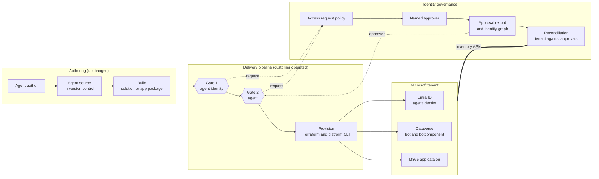
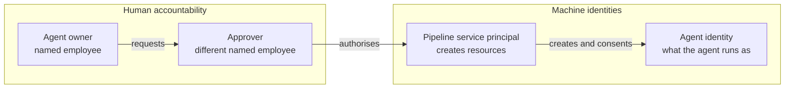
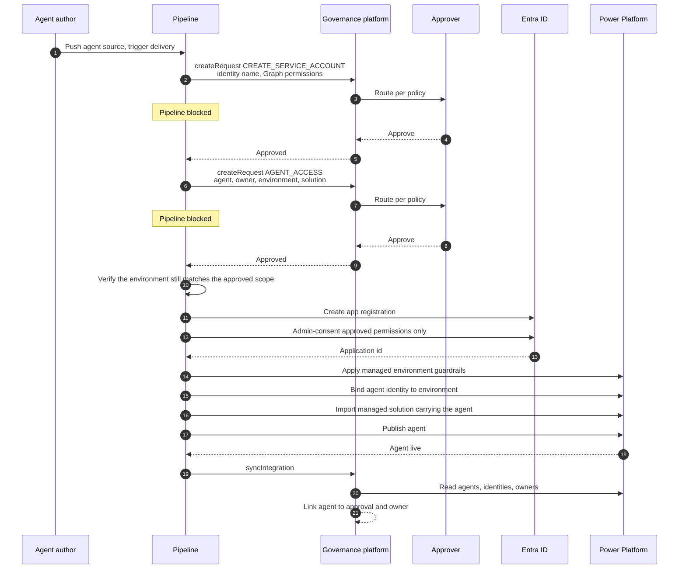
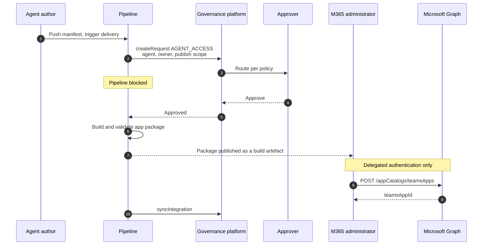
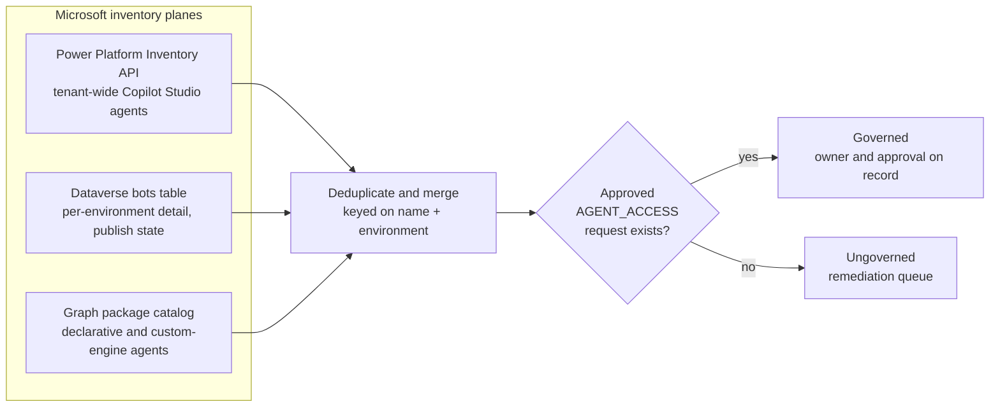

# Reference architecture: Microsoft Copilot agent lifecycle

This document describes the architecture of an approval-gated lifecycle for Microsoft
Copilot agents. It is the design companion to the working code in this repository.

Audience: identity, platform and security architects evaluating how to bring Copilot
agents under identity governance. It assumes familiarity with Entra ID and with either
Power Platform or the Microsoft 365 extensibility model, but not with BalkanID.

Contents:

- [Problem statement](#problem-statement)
- [Design principles](#design-principles)
- [Architecture overview](#architecture-overview)
- [Components](#components)
- [Trust boundaries and identities](#trust-boundaries-and-identities)
- [Control flow: Copilot Studio](#control-flow-copilot-studio)
- [Control flow: declarative agents](#control-flow-declarative-agents)
- [Control flow: discovery and reconciliation](#control-flow-discovery-and-reconciliation)
- [Deployment topologies](#deployment-topologies)
- [Failure modes](#failure-modes)
- [Platform constraints](#platform-constraints)
- [Extension points](#extension-points)
- [Non-goals](#non-goals)

## Problem statement

Microsoft provides preventive controls over Copilot agents, but they operate on
populations rather than on individual agents: environment security-group scoping, the
Environment Maker role, DLP policies, Managed Environment sharing limits, the custom app
upload tenant setting, and administrative toggles for Agent Builder. Each is configured
in advance and answers the question "may this group of makers create agents here".

What the platform does not provide is an approval step for a particular agent. There is
no supported way to require that a named person authorise this agent, with this owner,
reading these sources, before it exists.

That gap matters because Copilot is deliberately built for self-service authoring, and
the creation paths reflect it:

| Creation path | Who can use it | What is required |
|---|---|---|
| Copilot Studio portal | Any maker with access to an environment | No pipeline, no ticket, no review |
| Agent Builder in M365 Copilot | Any licensed user | No app registration, no Entra identity |
| Declarative agent sideload | Any developer, where custom app upload is permitted | A zipped app package |
| Power Platform solution import | A pipeline or an admin | Solution import rights |

A Copilot Studio agent is a row in the Dataverse `bot` table, accompanied by
`botcomponent` rows holding its topics and knowledge sources. Creating one is a data
operation inside an environment a maker already has, not an infrastructure operation
that passes through a change process.

The governance consequence is that identity teams learn about an agent after it exists,
has been shared, and is already reading corporate data on behalf of the people who talk
to it. The coarse controls above can prevent a population of makers from creating agents
at all, but they cannot record who authorised a particular one.

This architecture adds a per-agent approval for agents delivered through a pipeline, and
detection for the agents that are not. It does so without replacing the tooling teams
already use to build agents, because a control that requires abandoning Copilot Studio
will be bypassed.

The honest boundary: an approval gate governs what passes through it. A maker who opens
the Copilot Studio portal never encounters it. That is why reconciliation is part of the
architecture rather than an optional extra, and why the coarse platform controls remain
necessary alongside this one.

## Design principles

1. Fail closed. A denial, a timeout, or an unreachable policy service all stop the
   pipeline. Nothing is created on an unresolved decision.
2. Govern the intent, not the toolchain. The approval is a policy decision about an
   agent and the identity it will run as. It is not a pipeline step bound to one CI
   system, one IaC tool, or one Copilot surface.
3. Do not fight the platform. Copilot Studio agents move between environments as
   solution components, because that is how Dataverse works. The architecture packages
   them that way rather than modelling agent internals in infrastructure code.
4. Detective controls remain necessary. A preventive gate governs the agents that go
   through it. Reconciliation against tenant inventory finds the ones that did not.
5. Evidence is a first-class output. Every approval produces a durable record linking a
   named human, a named agent, a set of permissions, and a decision with a timestamp.
6. The record must describe what was created, not what was asked for. The approved scope
   is verified against the environment immediately before provisioning, so configuration
   cannot drift between the decision and the action.

## Architecture overview

Solid arrows carry artefacts. Dotted arrows carry policy decisions. The pipeline is
blocked at each gate until a decision returns.

The reconciliation loop re-checks the tenant against the approval record, so an agent
created outside the pipeline is surfaced rather than assumed away. It is the necessary
complement to the gate: together they cover both the agents that go through the pipeline
and the agents that do not.

## Components

| Component | Responsibility | Where it runs |
|---|---|---|
| Agent identity gate | Submits a `CREATE_SERVICE_ACCOUNT` request describing the Entra identity the agent will use and the Graph permissions it is requesting. Blocks until decided. | Pipeline runner |
| Agent gate | Submits an `AGENT_ACCESS` request describing the agent, its owner, and its target environment. Blocks until decided. | Pipeline runner |
| Identity stack | Creates the Entra app registration and admin-consents only the approved permissions. | Terraform, `azuread` provider |
| Platform stack | Applies environment guardrails, binds the agent identity to the environment, imports the solution carrying the agent. | Terraform, `microsoft/power-platform` provider |
| Publisher | Makes an imported agent live, or publishes an app package to the org catalog. | `pac` CLI or Microsoft Graph |
| Scope verifier | Compares the approved scope recorded by the gates against the environment about to be provisioned. Fails on drift. | Pipeline runner |
| Sync trigger | Asks the governance platform to re-read the connected integration so the new agent is discovered and linked to its owner. | Pipeline runner |
| Reconciler | Reads tenant agent inventory from three Microsoft planes, deduplicates, and compares against approved requests. | Scheduled job or pipeline step |

Each component is a single-purpose script or Terraform module, so a customer can adopt
a subset. The gates alone are useful without any of the provisioning.

## Trust boundaries and identities

Four distinct identities appear in this architecture. Conflating them is the most common
design error, because it collapses the segregation of duties the gates exist to create.

| Identity | Holds | Must not also be |
|---|---|---|
| Agent owner | Business accountability for the agent | The approver of their own request |
| Approver | Authority to grant the requested scope | The pipeline service principal |
| Pipeline service principal | Rights to create Entra objects and import solutions | The agent identity |
| Agent identity | Only the permissions that were approved | Reused across agents |

The pipeline service principal is powerful by necessity: it can create app registrations
and consent Graph permissions. It is therefore the highest-value credential in the
design, and the one that most warrants federated credentials rather than a secret. It
should never be reused as the identity an agent runs as, because that would give every
agent the rights needed to create more agents.

Trust boundaries crossed:

| Boundary | Crossed by | Authentication |
|---|---|---|
| Pipeline to governance platform | Gate scripts | Employee API key, or workload identity |
| Pipeline to Entra | Identity stack | Service principal, federated credential preferred |
| Pipeline to Power Platform | Platform stack | Service principal registered as a management app |
| Pipeline to M365 app catalog | Publisher | Delegated user token only, see platform constraints |
| Governance platform to Microsoft | Integration sync | The tenant's configured integration |

## Control flow: Copilot Studio

On a denial at either gate, the pipeline exits non-zero and no step to its right
executes. Nothing exists in Entra and nothing exists in Dataverse.

Two gates rather than one is a deliberate choice. The identity request and the agent
request often warrant different approvers: the permissions an agent asks for are an
identity decision, while whether the agent should exist at all is a business one. A
customer that wants a single approval can run the agent gate alone.

## Control flow: declarative agents

The break in automation at the publish step is a platform constraint, not a design
choice. It is described under [platform constraints](#platform-constraints).

## Control flow: discovery and reconciliation

Microsoft exposes agent inventory across three planes that do not reference each other.
A complete picture requires reading all three and correlating the results.

Deduplication matters for accuracy. The Inventory API and the Dataverse `bots` table
both see every Copilot Studio agent, so a naive union double-counts and overstates the
population. The reconciler merges on name plus environment and records which planes saw
each agent.

Reconciliation output drives two workflows: onboarding an ungoverned agent by assigning
an owner and raising a retrospective request, or decommissioning it. Run it on a
schedule rather than only in the pipeline, because the agents it is designed to find are
precisely the ones that never entered a pipeline.

## Deployment topologies

### Gate only

The pipeline calls the gate before whatever already creates agents. No Terraform, no
Microsoft credentials held by the governance integration beyond read access.

Appropriate when agent creation is already centralised in a pipeline the platform team
controls, and the gap is authorization rather than automation.

### Gate and provision

The full flow above. The pipeline holds a service principal able to create Entra objects
and import solutions.

Appropriate when moving agent creation out of the portal and into a reviewed path.

### Detect only

Reconciliation on a schedule, with no gate. Produces an inventory and an ungoverned
list, and drives retrospective ownership assignment.

Appropriate as a first step in a tenant with an established agent population, and as a
way to size the problem before committing to a pipeline.

The three topologies compose. Starting with detect-only is usually the least disruptive
sequence: it sizes the problem before anyone commits to a pipeline.

### Environment layering

Copilot Studio ALM is environment-based. A typical layering:

| Environment | Purpose | Gate |
|---|---|---|
| Development | Makers author freely | None, or notification only |
| Test | Validation and solution checker | Agent gate |
| Production | Live agents reachable by staff | Identity gate and agent gate, distinct approvers |

Gating development defeats the point of self-service authoring. Gating the promotion
into production is where the control belongs, and it maps onto the solution export and
import boundary the platform already imposes.

## Failure modes

| Failure | Behaviour | Rationale |
|---|---|---|
| Approver denies | Pipeline exits 1, nothing created | Preventive control |
| Approver grants less than requested | Pipeline exits 1, nothing created | A partial approval does not authorise the full requested scope |
| Approval window elapses | Pipeline exits 2, nothing created | Distinguishable from denial, still fails closed |
| Governance platform unreachable | Gate retries with backoff, then exits 3 | An unavailable policy service must not imply consent, and must be distinguishable from a denial |
| Configuration changes between approval and provisioning | Scope verifier exits 1, nothing created | The approval record must describe what was created |
| Identity created, agent gate later denied | Orphaned app registration | Documented; use remote state and a destroy path |
| Solution import fails after approval | Approval stands, no agent | Re-run is idempotent at the solution level |
| Agent imported but not published | Agent exists, is not reachable | Publish is a separate CLI step by platform design |
| Reconciler cannot read a plane | Reports `complete: false`, lists the failure, and exits 3 under `FAIL_ON_UNGOVERNED` | Silent under-reporting is worse than a visible gap, and a blind check must never read as a clean tenant |

The last row deserves emphasis. The Graph package catalog returns an empty result rather
than an error when the tenant lacks the required licensing, which would silently
under-report declarative agents. The reconciler treats a zero-row response from that
plane as a condition to report rather than a clean result, and marks the whole inventory
incomplete when any plane fails to read.

## Platform constraints

These are properties of Microsoft's platform as of September 2026. They constrain any
architecture in this space, not only this one, and they are the constraints most likely
to surprise an architect sketching a design on a whiteboard.

| Constraint | Consequence |
|---|---|
| No Terraform resource creates a Copilot Studio agent | The agent ships inside a solution package; Terraform imports the package |
| `pac copilot pack` emits an unmanaged solution, and no offline conversion exists | Import to a Dataverse environment and export managed before the pipeline consumes it |
| An imported agent is not live until published | Publish is a distinct CLI step after import |
| Graph app-catalog publish supports delegated permissions only | A service principal cannot publish a declarative agent |
| Entra Agent ID has no Terraform provider support in `hashicorp/azuread` | Platform-issued agent identities are reconciled, not provisioned |
| Copilot Studio agents created from May 2026 receive an Entra Agent ID automatically | The identity appears with the agent; review the intent, reconcile the object |
| Agent Builder agents have no Entra identity at all | Nothing to review at the identity layer; the agent gate is the only control |
| Authentication settings, channels and icons do not survive solution import | Post-import configuration is required |
| Graph package catalog requires Agent 365 licensing | Without it, declarative agent inventory is unavailable |

[`docs/AGENT_IDENTITY.md`](AGENT_IDENTITY.md) covers the identity constraints in depth.

## Extension points

| Extension | How |
|---|---|
| Long-running approvals | Resume from a `request.actioned` webhook instead of polling, so a multi-day approval does not hold a runner |
| A different IGA platform | Replace the gate script. The interface is a process that exits 0 on approval. [`docs/SAILPOINT.md`](SAILPOINT.md) implements one |
| A different CI system | The gate is a single command. Azure DevOps, GitLab CI and Jenkins work unchanged |
| Other agent platforms | The gate is platform-agnostic. The AWS Bedrock equivalent is [`agent-lifecycle-terraform-reference`](https://github.com/balkanid/agent-lifecycle-terraform-reference) |
| Lifecycle beyond creation | The same request model covers `ASSIGN`, `UNASSIGN` and `DELETE`. This reference implements `CREATE` |
| Periodic recertification | Reconciler output feeds an access review campaign over agents and their owners |

## Non-goals

This architecture does not address:

- Runtime or invoke-time authorization. It governs whether an agent may exist and what
  identity it holds, not what it does during a conversation. A runtime gateway is a
  separate and complementary control.
- Data loss prevention on agent knowledge sources. Power Platform DLP policies and
  Purview sensitivity labels cover that ground and are configured alongside this, not by
  it.
- Prompt and content safety. Microsoft's responsible AI validation applies to agents
  regardless of how they were provisioned.
- Agent-to-agent delegation and multi-agent orchestration.
- Azure AI Foundry agents. The pattern applies; the provisioning steps differ.

## References

Microsoft:

- [Export and import agents using solutions](https://learn.microsoft.com/en-us/microsoft-copilot-studio/authoring-export-import-bots)
- [Power Platform Inventory API](https://learn.microsoft.com/en-us/power-platform/admin/inventory-api)
- [Copilot package catalog, Microsoft Graph](https://learn.microsoft.com/en-us/microsoft-365-copilot/extensibility/api/admin-settings/package/overview)
- [Publish an app to the org catalog, Microsoft Graph](https://learn.microsoft.com/en-us/graph/api/teamsapp-publish?view=graph-rest-1.0)
- [Entra Agent ID](https://learn.microsoft.com/en-us/entra/agent-id/agent-identities)
- [Copilot Studio agent identities](https://learn.microsoft.com/en-us/microsoft-copilot-studio/govern-agents-identities-overview)
- [Power Platform Terraform provider](https://registry.terraform.io/providers/microsoft/power-platform/latest)

BalkanID:

- [Public API documentation](https://docs.balkan.id/)
